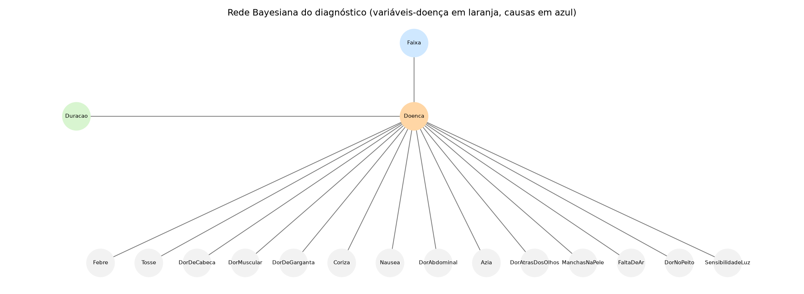

# Q8: Sistema de diagnóstico médico com Rede Bayesiana

Questão 8 da Lista 2 (AB2), IA PPGI 2026.2, prof. Evandro Costa.

> Desenvolver um sistema de diagnóstico médico com Rede Bayesiana: modelar relações de causa e efeito entre doenças e sintomas, realizar inferências diagnósticas com evidências incompletas ou incertas, e atualizar as probabilidades à medida que novas evidências são fornecidas.

> **Aviso:** as probabilidades são **ilustrativas**, definidas pelo autor com base em conhecimento clínico geral. Não foram estimadas a partir de dados reais nem validadas por um médico. O sistema é um protótipo acadêmico e **não substitui avaliação médica**.

## Como rodar

Usa pgmpy (testado com a versão 1.1.2) e matplotlib, além de networkx para o desenho do grafo.

```bash
pip install pgmpy matplotlib networkx      # ou o equivalente no seu ambiente

python3 bn_diagnostico.py      # monta a rede, salva o arquivo .bif, desenha o grafo e roda os experimentos
python3 -m unittest -v         # roda os 16 testes
```

## Arquivos

| Arquivo | Conteúdo |
|---|---|
| `bn_diagnostico.py` | Estrutura, tabelas de probabilidade, inferência, desenho do grafo e os quatro experimentos |
| `data/diagnostico.bif` | O modelo salvo no formato BIF (arquivo do projeto, lido pelo pgmpy) |
| `figuras/rede_bayesiana.png` | Grafo da rede |
| `test_bn.py` | Testes: estrutura, distribuições, conferência da inferência com uma fórmula direta, efeitos esperados e gravação do BIF |
| `README.md` | Este arquivo |

---

## 1. Domínio e variáveis

O domínio é o diagnóstico de cinco doenças comuns em atendimento de adultos e idosos. As doenças e os sintomas são os mesmos da **Q7** (sistema CBR), para que os resultados possam ser comparados.

A rede tem **17 variáveis**:

| Variável | Papel | Estados | Significado |
|---|---|---|---|
| `Faixa` | Causa (raiz) | Jovem, Adulto, Idoso | Faixa etária do paciente |
| `Doenca` | **Doença principal** (não observável) | Gripe, Dengue, Pneumonia, Enxaqueca, Gastrite | O diagnóstico que o sistema quer estimar |
| `Duracao` | Efeito | até 3 dias, 4 a 7 dias, mais de 7 dias | Há quanto tempo os sintomas estão presentes |
| 14 sintomas (`Febre`, `Tosse`, `DorDeCabeca`, `DorMuscular`, `DorDeGarganta`, `Coriza`, `Nausea`, `DorAbdominal`, `Azia`, `DorAtrasDosOlhos`, `ManchasNaPele`, `FaltaDeAr`, `DorNoPeito`, `SensibilidadeLuz`) | Efeitos (observáveis) | Não, Sim | Presença de cada sintoma |

## 2. Estrutura da rede



As arestas são:

```
Faixa ──► Doenca ──► Duracao
             │
             ├──► Febre, Tosse, DorDeCabeca, ..., SensibilidadeLuz   (14 arestas)
```

### Dependências justificadas

| Aresta | Justificativa |
|---|---|
| `Faixa → Doenca` | A idade muda a chance de cada doença. Pneumonia e gastrite são mais comuns em idosos, e dengue e enxaqueca mais em adultos e jovens. |
| `Doenca → Duracao` | Cada doença tem um curso típico. Gripe costuma passar em poucos dias, e gastrite crônica dura semanas ou mais. |
| `Doenca → sintoma` (14 arestas) | A doença causa os sintomas. Por exemplo, a pneumonia causa falta de ar e a dengue causa manchas na pele. Essa é a relação causal principal do domínio. |

A direção das arestas segue a causalidade: a doença causa os sintomas e não o contrário. Por isso não há arestas de sintoma para doença. Essa escolha é o que permite raciocinar de sintomas para diagnóstico com a regra de Bayes.

### Independências condicionais

A estrutura afirma que:

- **Cada sintoma é independente dos outros, dado a doença.** Por exemplo, sabendo que o paciente tem pneumonia, saber que ele tem tosse não muda a probabilidade de falta de ar.
- **`Faixa` e `Duracao` só afetam o diagnóstico por meio da doença.** Dado o diagnóstico, a idade não influencia diretamente os sintomas.

**Essa independência é uma simplificação.** Na realidade, tosse e falta de ar tendem a ocorrer juntas na pneumonia porque vêm do mesmo processo, então elas não são independentes nem dado a doença. Com a estrutura atual, o modelo subestima a correlação entre sintomas. Isso é discutido na seção 7.

### Hipóteses consideradas

1. A doença principal é uma só (não há coinfecção no modelo).
2. Os sintomas são observados sem erro. Um sintoma está presente ou ausente.
3. A população atendida tem a distribuição de faixas etárias definida na seção 3.
4. Os sintomas são independentes dado a doença (seção acima).
5. Os tratamentos são genéricos. O modelo trata só do diagnóstico.

## 3. Probabilidades (tabelas CPT)

Não há base real de dados. Todas as probabilidades são estimativas do autor, baseadas no conhecimento clínico geral sobre cada doença. Elas são **premissas**, não resultados de estudo. Os valores foram escolhidos para refletir as características típicas de cada doença:

- **Sintoma típico** da doença: probabilidade alta (0,80 a 0,95). Ex.: dor atrás dos olhos e manchas na pele na dengue, sensibilidade à luz na enxaqueca, azia na gastrite, falta de ar na pneumonia.
- **Sintoma comum, mas não exclusivo**: 0,40 a 0,75. Ex.: tosse na gripe, febre na dengue.
- **Sintoma raro para a doença**: 0,02 a 0,15.

### P(Faixa etária)

Jovem 0,30 · Adulto 0,45 · Idoso 0,25.

### P(Doença | Faixa etária)

| Faixa | Gripe | Dengue | Pneumonia | Enxaqueca | Gastrite |
|---|---|---|---|---|---|
| Jovem | 0,30 | 0,20 | 0,05 | 0,25 | 0,20 |
| Adulto | 0,25 | 0,20 | 0,10 | 0,25 | 0,20 |
| Idoso | 0,20 | 0,10 | 0,30 | 0,10 | 0,30 |

Cada linha soma 1. A pneumonia sobe com a idade. A dengue cai nos idosos, porque a exposição ao mosquito é maior em adultos e jovens (premissa).

### P(Duração | Doença)

| Duração | Gripe | Dengue | Pneumonia | Enxaqueca | Gastrite |
|---|---|---|---|---|---|
| até 3 dias | 0,70 | 0,60 | 0,10 | 0,60 | 0,05 |
| 4 a 7 dias | 0,25 | 0,35 | 0,35 | 0,20 | 0,25 |
| mais de 7 dias | 0,05 | 0,05 | 0,55 | 0,20 | 0,70 |

Cada coluna soma 1. A pneumonia dura mais que a gripe, e a gastrite costuma ser prolongada.

### P(Sintoma = Sim | Doença)

| Sintoma | Gripe | Dengue | Pneumonia | Enxaqueca | Gastrite |
|---|---|---|---|---|---|
| Febre | 0,85 | 0,90 | 0,85 | 0,10 | 0,10 |
| Tosse | 0,80 | 0,15 | 0,90 | 0,10 | 0,10 |
| DorDeCabeca | 0,60 | 0,60 | 0,30 | 0,95 | 0,25 |
| DorMuscular | 0,70 | 0,75 | 0,40 | 0,20 | 0,05 |
| DorDeGarganta | 0,60 | 0,15 | 0,20 | 0,05 | 0,05 |
| Coriza | 0,75 | 0,05 | 0,10 | 0,05 | 0,02 |
| Nausea | 0,15 | 0,45 | 0,15 | 0,60 | 0,55 |
| DorAbdominal | 0,05 | 0,25 | 0,05 | 0,05 | 0,90 |
| Azia | 0,02 | 0,02 | 0,02 | 0,05 | 0,85 |
| DorAtrasDosOlhos | 0,10 | 0,70 | 0,05 | 0,35 | 0,02 |
| ManchasNaPele | 0,02 | 0,40 | 0,02 | 0,02 | 0,02 |
| FaltaDeAr | 0,05 | 0,05 | 0,80 | 0,03 | 0,02 |
| DorNoPeito | 0,05 | 0,05 | 0,60 | 0,05 | 0,15 |
| SensibilidadeLuz | 0,05 | 0,05 | 0,05 | 0,80 | 0,05 |

A tabela dá P(Sim | Doença). P(Não | Doença) é 1 menos esse valor. Cada sintoma tem uma tabela CPT com duas linhas (Não, Sim) e cinco colunas (doenças).

**Justificativa dos valores mais importantes:**
- *Dengue:* dor atrás dos olhos (0,70) e manchas na pele (0,40) são os sinais mais característicos da doença, e quase não aparecem em outras das cinco.
- *Enxaqueca:* sensibilidade à luz (0,80) e dor de cabeça (0,95) são típicas, e quase não aparecem nas demais.
- *Pneumonia:* tosse (0,90) e falta de ar (0,80) são os sintomas mais frequentes, e por isso são usados para separar pneumonia de gripe.
- *Gripe:* coriza (0,75) e dor de garganta (0,60) são típicas, e tosse e febre são frequentes, mas menos específicas.
- *Gastrite:* dor abdominal (0,90) e azia (0,85) quase sempre estão presentes, e sensibilidade à luz e manchas na pele quase nunca.

## 4. Inferência

A inferência é feita com **eliminação de variáveis** (`VariableElimination` do pgmpy). Dado um conjunto de evidências, a rede calcula `P(Doenca | evidências)`. As evidências podem ser **parciais**: basta informar alguns sintomas, e os outros são somados (marginalizados) automaticamente.

Para conferir a implementação, os testes comparam o resultado do pgmpy com uma fórmula direta, feita sem a biblioteca:

```
P(D | e) ∝ [Σ_F P(F) · P(D|F)] · [Σ_Dur P(Dur|D)] · Π_s P(s | D)     (para cada sintoma observado s)
```

Os dois resultados batem com diferença menor que 10⁻⁹ em todos os casos testados.

## 5. Experimentos

### Experimento 1: diagnóstico a partir de sintomas observados (exemplo do enunciado)

Evidências: `Febre = Sim`, `Tosse = Sim`, `DorMuscular = Sim`.

| Doença | Priori | Posteriori |
|---|---|---|
| Gripe | 25,2% | **66,9%** |
| Pneumonia | 13,5% | 23,0% |
| Dengue | 17,5% | 9,9% |
| Enxaqueca | 21,2% | 0,2% |
| Gastrite | 22,5% | 0,1% |

A priori é a distribuição antes de qualquer sintoma, calculada pela faixa etária. A posteriori é a distribuição depois dos três sintomas. A gripe passa de 25% para 67%. A enxaqueca e a gastrite caem para quase zero, porque são pouco compatíveis com esses sintomas.

### Experimento 2: atualização do diagnóstico conforme os sintomas são incluídos

Os sintomas são adicionados um a um, e a distribuição é recalculada a cada passo:

| Evidência adicionada | Gripe | Dengue | Pneumonia | Enxaqueca | Gastrite |
|---|---|---|---|---|---|
| (priori) | 25,2% | 17,5% | 13,5% | 21,2% | 22,5% |
| Febre = Sim | 40,4% | 29,7% | 21,6% | 4,0% | 4,2% |
| Tosse = Sim | 56,7% | 7,8% | 34,1% | 0,7% | 0,7% |
| DorMuscular = Sim | 66,9% | 9,9% | 23,0% | 0,2% | 0,1% |
| FaltaDeAr = Sim | 15,0% | 2,2% | **82,7%** | 0,0% | 0,0% |
| DorNoPeito = Sim | 1,5% | 0,2% | **98,3%** | 0,0% | 0,0% |

A febre reduz muito a enxaqueca e a gastrite, que quase não causam febre (para cerca de 4% cada). A tosse separa gripe de dengue. Quando a falta de ar e a dor no peito aparecem, a pneumonia passa a dominar. Essa linha mostra a atualização bayesiana de forma direta: cada evidência muda a distribuição, e a anterior vira a nova priori.

### Experimento 3: comparação entre conjuntos de evidências diferentes

| Conjunto de evidências | Doença mais provável | Probabilidade |
|---|---|---|
| Febre, dor atrás dos olhos, manchas na pele, dor muscular | Dengue | 98,9% |
| Dor de cabeça, sensibilidade à luz, náusea | Enxaqueca | 94,8% |
| Dor abdominal, azia, náusea | Gastrite | 99,2% |

Cada conjunto de sintomas típicos leva a uma doença com alta probabilidade. Isso mostra que a rede separa as cinco doenças quando os sinais característicos aparecem.

### Experimento 4: efeito da faixa etária com os mesmos sintomas

Sintomas: `Febre = Sim`, `Tosse = Sim`, `DorMuscular = Sim`.

| Faixa | Gripe | Pneumonia | Dengue |
|---|---|---|---|
| Jovem | 79,8% | 8,5% | 11,3% |
| Adulto | 69,8% | 18,0% | 11,9% |
| Idoso | 48,2% | **46,5%** | 5,1% |

Os mesmos sintomas levam a diagnósticos diferentes conforme a idade. Em idosos, a pneumonia quase empata com a gripe, porque a doença é mais comum nessa faixa. É um caso em que a informação de idade muda a decisão, o que um sistema de regras simples teria mais dificuldade em capturar.

## 6. Análise dos resultados

### O que a rede faz bem

- **Lida com incerteza.** Mesmo com evidências fortes, o resultado é uma distribuição, não uma resposta. Com febre, tosse e dor muscular, a rede dá 67% para gripe e 23% para pneumonia, e não uma resposta única. Isso é mais honesto do que uma regra fixa.
- **Aceita evidências parciais.** Não é preciso informar todos os sintomas. A rede responde com o que houver, como mostra a seção 4.
- **Atualiza o diagnóstico com cada nova evidência** (Experimento 2), sem recalcular do zero.
- **Combina a faixa etária com os sintomas** (Experimento 4), mostrando como o contexto muda a probabilidade.
- **Permite explicação.** É possível mostrar a distribuição antes e depois de cada evidência e identificar quais sintomas mais pesaram.

### Limitações

- **As probabilidades são premissas do autor**, não estimativas de dados reais. Os números são plausíveis, mas os resultados dependem deles. Com dados reais, as tabelas deveriam ser aprendidas ou validadas com especialistas.
- **A independência condicional entre sintomas é uma simplificação forte.** Tosse e falta de ar, por exemplo, ocorrem juntas na pneumonia por causa do mesmo processo. Com a estrutura atual, o modelo trata essas evidências como independentes, então elas são contadas como se fossem duas informações separadas. Isso pode elevar a pneumonia além do que os dados justificariam quando os dois sintomas aparecem juntos (no Experimento 2, falta de ar e dor no peito levam a 98%). Não verifiquei esse efeito com dados reais.
- **Só uma doença é modelada.** Pacientes com duas doenças ao mesmo tempo não são representados.
- **Os sintomas são binários.** A intensidade da febre, por exemplo, não entra no modelo.

### Melhorias possíveis

1. Adicionar arestas entre sintomas que se correlacionam (ex.: `Tosse → FaltaDeAr`), para tirar a independência condicional forte. Isso aumenta as tabelas, mas corrige a dupla contagem.
2. Aprender as tabelas CPT a partir de um conjunto de casos (com os casos da Q7, por exemplo) e comparar com as probabilidades escritas à mão.
3. Usar evidências incertas (*soft evidence*), por exemplo "o paciente diz ter febre, mas não tem certeza".
4. Validar as probabilidades com um médico antes de qualquer uso real.

## 7. Relação com a Q7

A Q7 usa as mesmas cinco doenças e os mesmos sintomas. O sistema CBR chega ao diagnóstico por similaridade com casos passados, e a rede bayesiana chega por probabilidades condicionais. As duas abordagens são complementares: o CBR depende da base de casos e a rede depende das probabilidades definidas. Um sistema real poderia usar a rede para o diagnóstico e o CBR para mostrar casos parecidos ao profissional.

## 8. Demonstração

O enunciado pede um vídeo ou demonstração do sistema. O comando `python3 bn_diagnostico.py` mostra a rede, o modelo salvo e os quatro experimentos, e o arquivo `data/diagnostico.bif` pode ser aberto em outras ferramentas de redes bayesianas (como Netica ou GeNIe) para mostrar o modelo graficamente. O vídeo precisa ser gravado com essas execuções.
